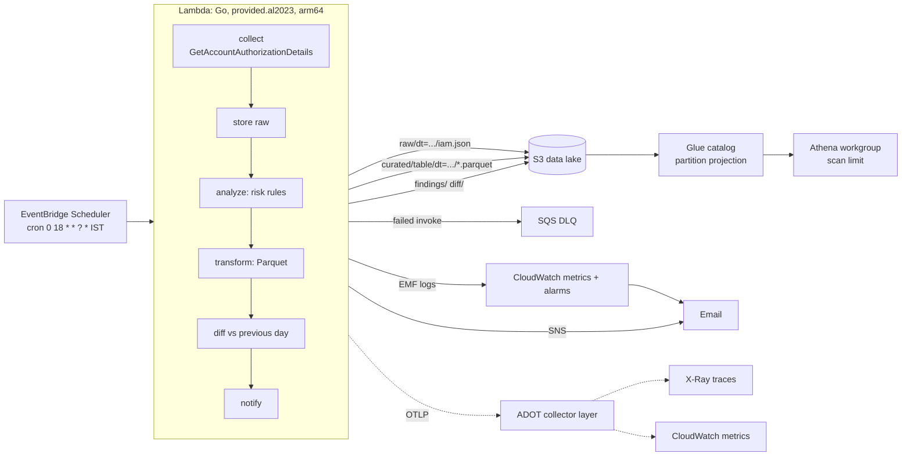

# IAM Inventory Pipeline

A serverless Go + Terraform pipeline that snapshots AWS IAM (users, groups, roles, policies, access keys) every day at **6 PM IST**, stores it as a date-partitioned data lake in S3, makes the history queryable with Athena, flags risky permissions, tells you what changed since yesterday, and is fully instrumented with **OpenTelemetry**.

> Status: code, tests and Terraform are complete and validated offline. Nothing has been deployed yet, because no AWS credentials have been provided. [docs/USER_ACTIONS.md](docs/USER_ACTIONS.md) lists exactly what to do to deploy it.

> New here? Read [docs/PROJECT_GUIDE.md](docs/PROJECT_GUIDE.md) first.

## Architecture



## What it demonstrates

| Area | Where |
| --- | --- |
| Go + AWS SDK v2, pagination, retry/backoff | [internal/collector](internal/collector), [cmd/lambda](cmd/lambda/main.go) |
| Data engineering: JSON to Parquet, Hive-style partitions, Glue + Athena with partition projection | [internal/transform](internal/transform), [terraform/modules/glue](terraform/modules/glue) |
| Security analytics: wildcard admin, broad PassRole, external/any-principal trust, stale keys | [internal/analyze](internal/analyze) |
| Change detection (daily diff, tolerant of missed days, ignores volatile fields) | [internal/analyze/diff.go](internal/analyze/diff.go) |
| IaC: modular Terraform, S3 remote state with native locking, least-privilege IAM | [terraform/](terraform) |
| CI/CD with GitHub OIDC (no static keys), plan on PR, approval-gated apply | [.github/workflows](.github/workflows) |
| Observability: OpenTelemetry traces + metrics, trace-correlated logs, CloudWatch alarms | [docs/OBSERVABILITY.md](docs/OBSERVABILITY.md) |

## Try it now, no AWS needed

```bash
make test         # unit + end-to-end tests (race detector on)
make local-demo   # full pipeline on sample data; prints OpenTelemetry spans to stderr
find out -type f  # raw JSON, 8 Parquet tables, findings.json, diff.json
```

## Data layout

```
s3://<bucket>/raw/dt=YYYY-MM-DD/iam.json                      full snapshot
s3://<bucket>/curated/<table>/dt=YYYY-MM-DD/<table>.parquet   roles, users, groups, policies,
                                                              role_policy_attachments,
                                                              trust_relationships, access_keys, findings
s3://<bucket>/findings/dt=YYYY-MM-DD/findings.json            human-readable findings
s3://<bucket>/diff/dt=YYYY-MM-DD/diff.json                    added / removed / modified since last snapshot
```

`dt` is the **IST** date. Keys are deterministic, so re-running on the same day overwrites rather than duplicates. The Glue column definitions are generated from the Go row structs (`make schema`), and a test fails if they drift.

## Design decisions

- **One API call, not N.** `GetAccountAuthorizationDetails` returns everything in a few pages, avoiding IAM throttling. Only `ListAccessKeys` is called per user.
- **Unattached AWS managed policies are skipped** by default (about 1,000 policies, many MB, no analytic value). Set `INCLUDE_UNATTACHED_AWS_POLICIES=true` to keep them.
- **Two metric paths on purpose.** OpenTelemetry metrics go through the collector to any backend. A CloudWatch EMF log line is also emitted so the alarms (including "no successful run in 26 hours") keep working even if the collector layer is not configured.
- **Vendor-neutral telemetry.** The code only speaks OTLP. Swapping X-Ray for Grafana, Honeycomb or Jaeger is a change to [otel/collector.yaml](otel/collector.yaml), not to Go code.
- **Failed alert fails the run**, so the Lambda error alarm and DLQ catch it. Data is already stored by then.
- **Fixed IST offset** instead of tzdata, so the binary does not depend on timezone files.
- **Least privilege** for the function role; `iam:GetAccountAuthorizationDetails` is `Resource: *` only because the API requires it. `s3:ListBucket` is included deliberately: without it a missing key returns 403 instead of 404.

## Repository layout

```
cmd/lambda        scheduled entrypoint        cmd/local      same pipeline, offline or against real AWS
cmd/schemagen     Go structs -> Glue schemas  internal/*     collector, analyze, transform, store, telemetry, pipeline
terraform/        bootstrap/ modules/ envs/dev/ sandbox_identities/
otel/             collector config packaged with the Lambda
docs/             USER_ACTIONS (start here), OBSERVABILITY, RUNBOOK, SECURITY
```

## Resume bullets (fill in the numbers after your first real run)

- Built a serverless Go pipeline (Lambda, EventBridge Scheduler) that snapshots AWS IAM daily into a date-partitioned S3 data lake, queryable with Athena via Glue partition projection; `<N>` roles / `<N>` policies per run.
- Implemented IAM risk detection (wildcard admin, broad `iam:PassRole`, external-account trust, stale access keys) and a day-over-day diff engine with SNS alerting.
- Instrumented the service with OpenTelemetry (traces, metrics, trace-correlated structured logs) exported through the ADOT collector to X-Ray and CloudWatch; alarms on errors, DLQ depth and missing runs.
- Provisioned everything with modular Terraform (S3 state with native locking) and deployed via GitHub Actions using OIDC, with no static credentials; enforced tflint, checkov and golangci-lint in CI.
